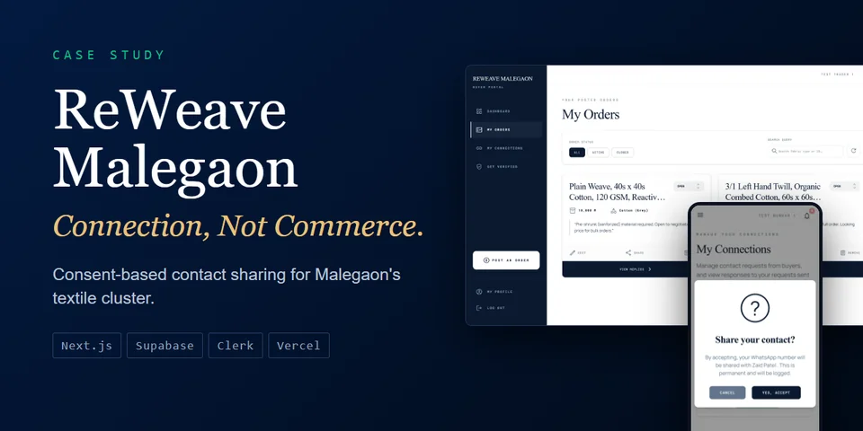
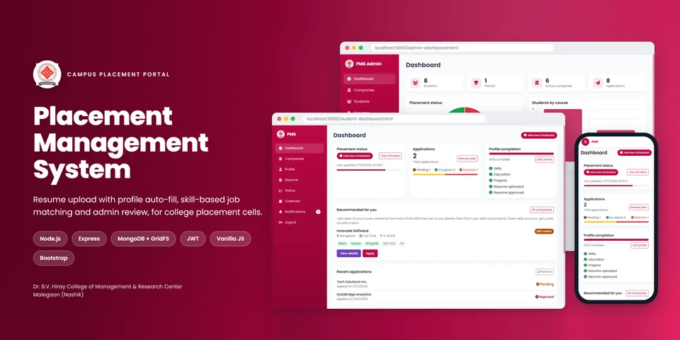
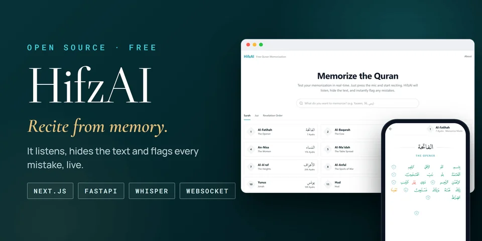

<h1 align="center">Hi, I'm Umair Basharti</h1>

Full-stack developer in Mumbai, open to relocate. MCA, Savitribai Phule Pune University. 
I build web applications from the database to the screen, and I'm looking for an entry-level software developer role.

<a href="https://umairbasharti.vercel.app">Portfolio</a> ·
<a href="https://www.linkedin.com/in/umair-basharti">LinkedIn</a> ·
<a href="resume/Umair-Basharti-Resume.pdf">Resume</a> ·
<a href="https://reweave-red.vercel.app">ReWeave live demo</a>

## Projects

<table>
<tr>
<td width="33%" valign="top">
 
<b>ReWeave Malegaon</b> 
A verified registry for Malegaon's textile cluster. Buyers, weavers and suppliers find each other, and contact details are shared only after both sides agree. 
Next.js 16, Supabase, Clerk. 40 pages, 43 API routes, 16 tables with row-level security, 65 unit tests. 
<a href="https://reweave-red.vercel.app">Live demo</a> · <a href="https://github.com/UmairBasharti/reweave-showcase">Case study</a>
</td>
<td width="33%" valign="top">
 
<b>Placement Management System</b> 
A placement portal for a college. Students upload a resume and get jobs ranked by skill match; the placement cell reviews resumes and tracks every application. 
Node.js, Express, MongoDB, JWT. 65 unit tests, CI, no vulnerable production dependencies. 
<a href="https://github.com/UmairBasharti/placement-management-system">Repository</a>
</td>
<td width="33%" valign="top">
 
<b>HifzAI</b> 
A free, open-source Quran memorization app. You recite from memory, and it listens, hides the text and flags mistakes word by word. 
Next.js 16, FastAPI, faster-whisper, WebSocket. CI on four jobs, tested from a clean download. 
<a href="https://github.com/UmairBasharti/hifzquran">Repository</a>
</td>
</tr>
</table>

## What I work with

- **Languages:** JavaScript, Python, C++
- **Front end:** React, Next.js, Tailwind CSS, HTML and CSS
- **Back end:** Node.js, Express, FastAPI, REST APIs
- **Data:** PostgreSQL (Supabase), MongoDB
- **Tools:** Git, GitHub Actions, Vercel

## How I work

- **Research:** understand the field first. For ReWeave, a semester of fieldwork in Malegaon's textile cluster.
- **Plan:** decide the scope, data model and architecture before building.
- **Build:** step by step, with automated tests and CI.
- **Verify and document:** check against the real system, then write setup guides others can follow.

## Research

The idea behind ReWeave comes from my own field research on Malegaon's textile cluster. The paper was published in the Akshardhara Research Journal and presented at the Interdisciplinary National Conference, Bhusawal Arts College, September 2025.
